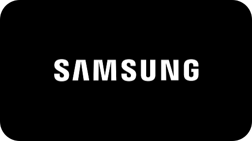
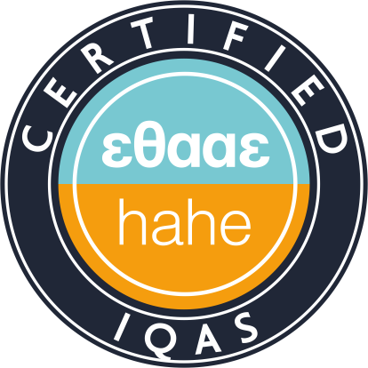

Professional roles and service activities, listed in reverse chronological order. Further details and selected achievements will be added.

## European Projects Coordinator

::: {.eu-experience style="display: flex; flex-wrap: wrap; gap: 2rem; align-items: flex-start;"}
::: {.eu-details style="flex: 1 1 480px; min-width: 0;"}
**Aristotle University of Thessaloniki (AUTH) & Aetoi Thessalonikis**

*January 2026 – Present*

I contribute to the development, coordination, and implementation of EU-funded projects across education, research, social inclusion, disability, and sport.

My work spans the project lifecycle, from identifying funding opportunities and establishing international partnerships to proposal development, project implementation, and delivery.

**Funding programmes:** Erasmus+, Horizon Europe, CERV, and other European funding instruments.

**Key responsibilities and achievements:**

- Identification and evaluation of European funding calls.
- Development of international partnerships and expansion of expert networks.
- Preparation and writing of project proposals, including successful funding applications.
- Coordination and implementation of EU-funded projects.
- Development of educational materials, research reports, questionnaires, digital platforms, and other project deliverables.
- Organisation of project meetings, workshops, and events.
- Participation in transnational project meetings and international project-related travel, collaborating with partners across Europe.
:::

::: {.eu-logos style="flex: 0 1 190px; text-align: center;"}
[{width=170px}](https://www.auth.gr/en/)

[{width=170px}](https://aetoithessalonikis.gr/en/)
:::
:::

## Customer Service & Technical Support

::: {.samsung-experience style="display: flex; flex-wrap: wrap; gap: 2rem; align-items: flex-start;"}
::: {.samsung-details style="flex: 1 1 480px; min-width: 0;"}
**Samsung · Full-time**

*August 2025 – December 2025*

- Provided customer support for Samsung products and services, focusing on customer satisfaction and issue resolution.
- Diagnosed and resolved technical issues across multiple Samsung product lines.
- Provided product education and troubleshooting guidance to customers.
:::

::: {.samsung-logo style="flex: 0 1 190px; text-align: center;"}
[{width=170px}](https://www.samsung.com/)
:::
:::

## Data Analyst

::: {.polihome-experience style="display: flex; flex-wrap: wrap; gap: 2rem; align-items: flex-start;"}
::: {.polihome-details style="flex: 1 1 480px; min-width: 0;"}
**PoliHome · Full-time**

*August 2024 – November 2024*

- Worked within the Data Entry department, managing and processing large volumes of data.
- Maintained data accuracy within the company's database.
- Used Microsoft Excel, coding, and macros to support data processing.
:::

::: {.polihome-logo style="flex: 0 1 190px; text-align: center;"}
[{width=170px}](https://www.polihome.gr/)
:::
:::

## External Evaluation & Accreditation Panel Member

::: {.hahe-experience style="display: flex; flex-wrap: wrap; gap: 2rem; align-items: flex-start;"}
::: {.hahe-details style="flex: 1 1 480px; min-width: 0;"}
**Hellenic Authority for Higher Education (HAHE)**

*November 2021 – September 2024*

Selected as a student representative within the HAHE Students’ Register, I participated in External Evaluation and Accreditation Panels for undergraduate study programmes at Greek universities, collaborating with international academic experts.

**Key responsibilities:**

- External evaluation and accreditation of undergraduate study programmes.
- Assessment of academic quality, curricula, institutional practices, and alignment with international higher education standards.
- Interviews with faculty members, students, alumni, and administrative staff.
- Development of recommendations for academic staff and university leadership to enhance educational quality.
- Co-authoring official accreditation reports and contributing to recommendations submitted to the Ministry of Education.

**Accreditation panels:**

- **University of Western Macedonia** — Mathematics (June 2024). [Accreditation report (PDF)](https://math.uowm.gr/wp-content/uploads/sites/3/2024/09/Final-Accreditation-Report-Mathematics-UWM.pdf)
- **University of the Aegean** — Statistics and Actuarial-Financial Mathematics (December 2022). [Accreditation document (PDF)](https://www.actuar.aegean.gr/images/articles/%CE%91%CF%80%CE%BF%CF%86.%20%CE%A0%CE%A0%CE%A3%20%CE%A3%CE%A4%CE%91%CE%A4%CE%99%CE%A3%CE%A4%CE%99%CE%9A%CE%97%CE%A3%20%CE%9A%CE%91%CE%99%20%CE%91%CE%9D%CE%91%CE%9B%CE%9F%CE%93%CE%99%CE%A3%CE%A4%CE%99%CE%9A%CE%A9%CE%9D.pdf)
- **University of Thessaly** — Mathematics (October 2022). [Accreditation report (PDF)](https://math.uth.gr/wp-content/uploads/2023/06/Final-Accreditation-Report-Mathematics-University-of-Thessaly.pdf)
:::

::: {.hahe-logo style="flex: 0 1 190px; text-align: center;"}
[{width=170px}](https://www.ethaae.gr/)
:::
:::
