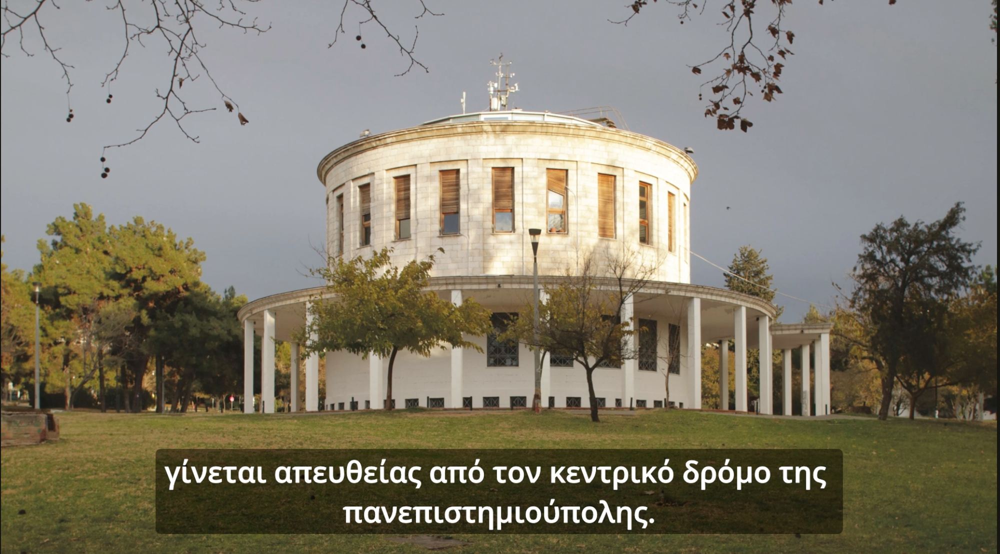

## Mathematics education — Conference presentation

::: {.kalamari-layout}
::: {.kalamari-text}
**2026 proceedings · Conference contribution · pp. 63–76**

**Sfondylis, S., & Moustakas, D.** *From the Blackboard to Adventure: A Mathematical “Treasure Hunt” for Congruent Triangles.*

Developed during the Mathematics Teaching Practicum at Aristotle University of Thessaloniki, this classroom activity engaged ninth-grade students in applying the **criteria for triangle congruence** through a mathematical treasure hunt. It combined cooperative, inquiry-based and game-based learning to encourage participation and mathematical reasoning.

**Proceedings:** *Conference on Mathematics and Their Teaching*, École Franco-Hellénique de Kalamari, Thessaloniki.

[Read the paper in the proceedings (p. 63)](https://www.kalamari.gr/images/2026/Praktika%202026_maths.pdf#page=63) · [Conference website](https://www.kalamari.gr/index.php/upcoming-events/events/synedrio-maths)
:::

::: {.kalamari-preview}

<small>Conference group photo · Click to enlarge</small>
:::
:::

## Accessibility in higher education

::: {.accessibility-layout}
::: {.accessibility-text}
**2025 · Social Contribution Award · Faculty of Sciences, Aristotle University of Thessaloniki**

I created an **accessibility video guide for people with disabilities**, documenting accessible routes and facilities within the Department of Mathematics, the Faculty of Sciences, and the wider Aristotle University of Thessaloniki campus. Featured on the Department of Mathematics' official accessibility page, the initiative supports more inclusive access to university facilities.

[Official Department of Mathematics accessibility page](https://math.auth.gr/en/access/) · [Watch the accessibility video on YouTube](https://www.youtube.com/watch?v=ztu2QVhWIkw) · [University award announcement (PDF)](https://www.auth.gr/wp-content/uploads/ANNOUNCEMENT-5.pdf)
:::

::: {.accessibility-preview}

<small>Accessibility initiative · Click to enlarge</small>
:::
:::

## Undergraduate thesis: Markov chains and cancer metastasis

::: {.thesis-layout}
::: {.thesis-text}
**2024 · Undergraduate thesis**

*Using Markov Chain Theory and R to Describe Cancer Metastasis Patterns Based on 3,827 Autopsies*

**Supervisor:** [Associate Professor Alexandra Papadopoulou](https://math.auth.gr/en/member/papadopoulou-alexandra/), Department of Mathematics, Aristotle University of Thessaloniki.

Using a dataset of **3,827 autopsies**, I applied Markov chain models in **R** to investigate patterns of cancer spread between anatomical sites.
:::

::: {.thesis-preview}

<small>Click to enlarge</small>
:::
:::

## iGEM Thessaloniki — Theriac

::: {.igem-layout}
::: {.igem-text}
**2021–2022 · Synthetic biology · Silver medal (2022)**

As a **team member and group leader** of iGEM Thessaloniki, I contributed to **Theriac**, a synthetic biology project focused on glioblastoma.

The team proposed a molecular *theranostic* approach combining cancer-cell detection and therapeutic action. The concept uses DNA-based molecular components and explores intranasal delivery to address the blood–brain barrier.

The project received a **silver medal** at the 2022 iGEM competition.

[Explore the official Theriac project website](https://2022.igem.wiki/thessaloniki/index) · [Project description](https://2022.igem.wiki/thessaloniki/description)
:::

::: {.igem-preview}

<small>Theriac · iGEM Thessaloniki 2022</small>
:::
:::
