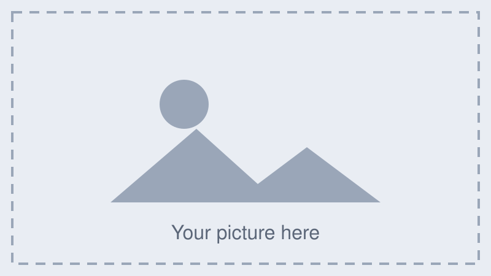

---
# ===============================
# RESEARCH PAGE (research.qmd)
# A short introduction to your research. Edit the lines marked FIXME.
#
# ABOUT COMMENTS
# Comments are notes for you. They never show on your website.
#   PART 1: the settings, between the two --- lines (where you are now)
#           A comment starts with #
#   PART 2: the page text, below the second ---
#           A comment is wrapped like this: <!-- your comment -->
# ===============================

# ---- PAGE TITLE ----
# The big heading at the top of this page. Change it to anything,
# e.g. "My Research", "What I Study", "Projects".
# Tip: this doesn't change the menu label. To change that too,
# edit the "text:" line for this page in _quarto.yml.
title: "Research"
---

<!-- You are now in PART 2: the page text. Comments look like this one. -->

<!--
  YOUR RESEARCH IN A FEW SENTENCES
  Write for someone outside your field, like a friend or a new lab mate.
  Answer one or more of these:
  - What question are you trying to answer?
  - Why does it matter, and to whom?
  - How did you get interested in it?
  Short is better: 1 or 2 paragraphs is plenty.
-->

[Write a few sentences about what you study and why it matters to you.]

[Optional: a second paragraph about how you got here, or where you want to take this work.]

<!--
  ADD A PICTURE (optional)
  A photo from the field, the lab, or a figure from your work.
  Right now this shows a placeholder image.

  TO USE YOUR OWN:
  1. On GitHub, open the "images" folder.
  2. Click "Add file" > "Upload files" and drag in your picture.
  3. In the line below, change images/placeholder.svg to your
     file name EXACTLY (e.g. images/field-site.jpg).

  WHAT EACH PART DOES:
  [ ]          the caption shown under the picture (this helps people who use screen readers.)
  ( )          the picture's file name
  fig-alt      a description for people using screen readers
  width        how big it is: try 40%, 60%, 100%
  fig-align    where it sits: left, center, or right

  DON'T WANT A PICTURE? Delete the line below.
  More picture options: https://quarto.org/docs/authoring/figures.html
-->

{fig-alt="Describe the picture here" width="60%" fig-align="center"}

## Find my work

<!--
  Link to the places where your work lives. Delete any you don't use.
  Don't have these yet? They're free and take a few minutes:
  - ORCID: a permanent ID that links all your work to you, even if
    your name changes. Get one: https://orcid.org/register
  - Google Scholar profile: https://scholar.google.com/citations
  To make a link: [text people see](https://the-web-address)
-->

- [ORCID](https://orcid.org/0000-0000-0000-0000) <!-- FIXME -->
- [Google Scholar](https://scholar.google.com) <!-- FIXME -->
- [GitHub](https://github.com/YOUR-USERNAME) <!-- FIXME: your code -->

<!--
  WANT TO ADD MORE LATER?
  As your work grows, you can add sections like these:
  ## Projects
  ## Publications
  ## Presentations
  Each one starts with ## and a name.
-->
