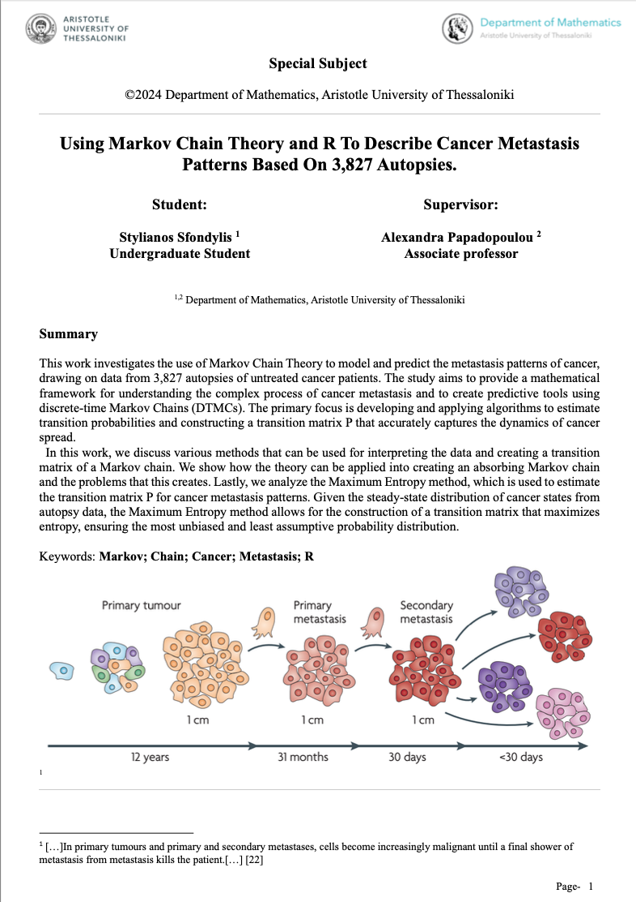
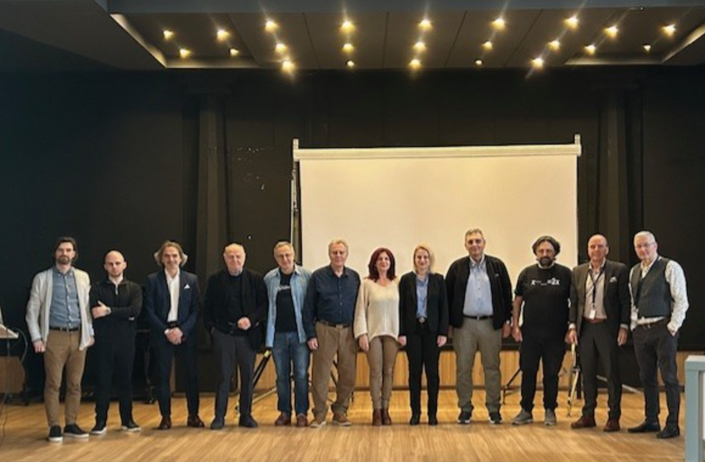

## Undergraduate thesis: Markov chains and cancer metastasis

::: {.thesis-layout}
::: {.thesis-text}
**2024 · Undergraduate thesis**

*Using Markov Chain Theory and R to Describe Cancer Metastasis Patterns Based on 3,827 Autopsies*

**Supervisor:** [Associate Professor Alexandra Papadopoulou](https://math.auth.gr/en/member/papadopoulou-alexandra/), Department of Mathematics, Aristotle University of Thessaloniki.

The thesis applied Markov chain theory and R to the study of cancer metastasis patterns based on data from 3,827 autopsies.
:::

::: {.thesis-preview}

<small>Click to enlarge</small>
:::
:::

## iGEM Thessaloniki — Theriac

::: {.igem-layout}
::: {.igem-text}
**2021–2022 · Synthetic biology · Silver medal (2022)**

As a **team member and group leader** of iGEM Thessaloniki, I contributed to **Theriac**, a synthetic biology project focused on glioblastoma.

The team proposed a molecular *theranostic* approach combining cancer-cell detection and therapeutic action. The concept uses DNA-based molecular components and explores intranasal delivery to address the blood–brain barrier.

The project received a **silver medal** at the 2022 iGEM competition.

[Explore the official Theriac project website](https://2022.igem.wiki/thessaloniki/index) · [Project description](https://2022.igem.wiki/thessaloniki/description)
:::

::: {.igem-preview}

<small>Theriac · iGEM Thessaloniki 2022</small>
:::
:::

## Mathematics education — Conference presentation

::: {.kalamari-layout}
::: {.kalamari-text}
**Conference contribution · Mathematics education · Proceedings (2026), pp. 63–76**

**Sfondylis, S., & Moustakas, D.** *From the Blackboard to Adventure: A Mathematical “Treasure Hunt” for Congruent Triangles.*

This paper describes a classroom teaching activity developed during the Mathematics Teaching Practicum at Aristotle University of Thessaloniki. Ninth-grade students applied the **criteria for triangle congruence** through a mathematical treasure hunt, combining experiential, cooperative, inquiry-based and game-based learning.

The activity encouraged active participation and mathematical reasoning; the authors report positive responses from students and teachers.

**Published in:** *Conference on Mathematics and Their Teaching*, École Franco-Hellénique de Kalamari, Thessaloniki, 2026 proceedings, **pp. 63–76**.

[Read the paper in the proceedings (p. 63)](https://www.kalamari.gr/images/2026/Praktika%202026_maths.pdf#page=63) · [Conference website](https://www.kalamari.gr/index.php/upcoming-events/events/synedrio-maths)
:::

::: {.kalamari-preview}

<small>Conference group photo · Click to enlarge</small>
:::
:::

## Accessibility in higher education

**2025 · Recognition for accessibility initiative**

I initiated and developed an informational video guide to support navigation and accessibility for students with disabilities at Aristotle University of Thessaloniki. The work received recognition from the Deanship of the School of Sciences in 2025.
